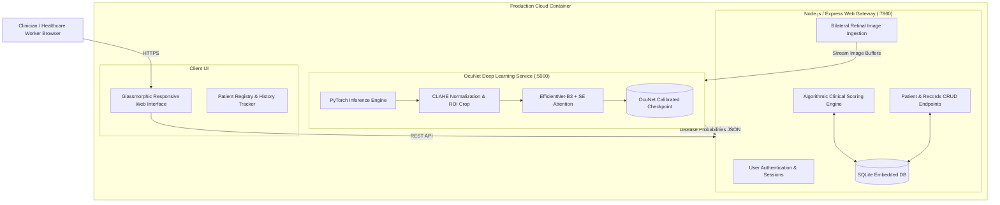

# VIRSA: AI-Powered Retinal Screening & Clinical Eye Health Platform

[](https://virsa.onrender.com)
[](https://virsa.onrender.com)
[](https://pytorch.org/)
[](https://nodejs.org/)
[](https://www.docker.com/)
[](https://sqlite.org/)
[](https://opensource.org/licenses/MIT)

> 🏆 **1st Prize Winner — Intersect 2026**  
> **Intersect 2026** was a national-level, 24-hour interdisciplinary healthcare hackathon hosted by the **Helix Innovation Club (BCMCH IEDC & BCMCH E-Cell)** at **Believers Church Medical College Hospital (BCMCH)**. Our team was awarded **1st Place** for designing, engineering, and deploying **VIRSA**—an automated clinical-grade ocular screening system—within the intense 24-hour development marathon.

---

## 🌟 The Hackathon Journey: Intersect 2026 (24-Hour Healthcare Sprint)

At **Intersect 2026**, our interdisciplinary challenge was to tackle the severe bottleneck in clinical ophthalmology triage: millions of patients in both primary healthcare centers and underserved rural areas lack access to timely retinal screening, leading to preventable vision loss from conditions like Diabetic Retinopathy, Glaucoma, and Age-Related Macular Degeneration (AMD).

### What We Built & Delivered in 24 Hours:
1. **Clinical AI Diagnostics:** Integrated and calibrated **OcuNet**, a deep learning multi-label classification engine capable of diagnosing **28+ ocular conditions** from bilateral fundus photos with a **93.68% Macro ROC-AUC**.
2. **Dual-Modality Systemic Scoring:** Designed a medical risk algorithm correlating biochemical markers (HbA1c, IOP, corneal thickness, blood pressure, lipid profiles) into a composite **Eye Health Index**.
3. **Longitudinal Patient History Tracking:** Implemented a full-stack clinical registry allowing healthcare workers to create patient profiles, track historical risk trajectories, and review past photographic records.
4. **Cloud Containerization & Production Deployment:** Successfully packaged the entire dual-stack application (Node.js Express + Python PyTorch) into a Docker container and deployed it live to the cloud within the hackathon timeframe.

---

## 🌐 Live Deployment
* **Production Web Application:** [https://virsa.onrender.com](https://virsa.onrender.com)
* **Architecture:** Containerized Docker workload running Node.js 20 & Python 3.10 PyTorch inference engine with automated continuous deployment.

---

## 🏗️ System Architecture



---

## 🔬 Core Capabilities

### 1. Dual-Modality Clinical Intelligence
* **OcuNet Computer Vision:** Processes high-resolution retinal fundus images through a modified **EfficientNet** backbone augmented with **Squeeze-and-Excitation (SE) attention blocks**, classifying up to 28+ distinct retinal pathologies simultaneously.
* **Systemic Risk Scoring:** Integrates clinical laboratory markers with gold-standard diagnostic guidelines:
  * **Diabetic Retinopathy (DR):** Stratified by HbA1c levels, duration of diabetes, systolic blood pressure, microalbuminuria/renal status, and lipid panels (cholesterol, LDL, triglycerides).
  * **Glaucoma Risk:** Computed using Intraocular Pressure (IOP), Central Corneal Thickness (CCT), visual field pattern standard deviations, and family history.
  * **Age-Related Macular Degeneration (AMD):** Evaluated against patient age brackets, smoking history, hypertension, and physical lifestyle indicators.

### 2. Patient Management & Longitudinal History
* Individualized patient profiles with historical trend tracking.
* Chronological assessment logs allowing clinicians to compare eye health scores and AI diagnostic probabilities over time.
* Bilateral image tracking (left eye and right eye captured and analyzed independently).

### 3. Production-Optimized Inference
* Model weights optimized from training checkpoints to an inference-only artifact, reducing memory overhead to run comfortably in cloud container tiers.
* Asynchronous microservice communication between Express and Flask using internal process pipelines.

---

## 📊 Deep Learning Model Benchmarks (OcuNet)

The underlying convolutional neural network was trained on combined high-grade retinal datasets (including RFMiD and multi-class clinical fundus sets) using **Asymmetric Loss (ASL)** to handle long-tail disease distributions:

| Clinical Pathology | Sensitivity / Recall | Status |
| :--- | :---: | :---: |
| **Cataract** | **100.0%** | Optimal |
| **Macular Hole (MH)** | **100.0%** | Optimal |
| **Glaucoma** | **96.3%** | Clinical Screening Grade |
| **Diabetic Retinopathy (DR)** | **96.2%** | Clinical Screening Grade |
| **Myopia (MYA)** | **93.8%** | High Reliability |
| **Age-Related Macular Degeneration (ARMD)** | **90.3%** | High Reliability |
| **Overall Macro ROC-AUC** | **93.68%** | State-of-the-Art |

---

## 🩺 Clinical Scoring Methodology

VIRSA computes clinical risk using strict medical cutoffs:

```
Total Eye Health Index = DR Score + Glaucoma Risk Index + AMD Risk Index
```

* **HbA1c (< 6.5% Normal, 6.5–7.4% Moderate, 7.5–8.4% Elevated, > 8.5% Critical)**
* **Intraocular Pressure (< 21 mmHg Normal, 22–25 mmHg Borderline, > 25 mmHg High Risk)**
* **Central Corneal Thickness (> 580 µm Protective, 540–580 µm Average, < 540 µm Vulnerable)**
* **Systolic Blood Pressure (< 130 mmHg Controlled, 130–139 mmHg Prehypertension, ≥ 140 mmHg Hypertensive)**

---

## 🔌 API Reference

### Authentication
* `POST /api/signup` — Register clinician account (`username`, `phone`, `dob`).
* `POST /api/login` — Authenticate existing account (`username`, `phone`).

### Patient Registry
* `GET /api/people/:userId` — List all registered patients for a user.
* `POST /api/people` — Create a new patient record (`name`, `age`, `date`, `address`).
* `GET /api/people/:personId/reports` — Retrieve historical diagnostic reports for a patient.

### Clinical Assessment & AI
* `POST /api/people/:personId/score` — Submit assessment data and optional retinal images (`multipart/form-data`: `leftEye`, `rightEye`, `scoreData`, `eyeHealthValue`, `drScore`, `glaucomaScore`, `amdScore`).

---

## 💻 Tech Stack

* **Frontend:** Vanilla JavaScript (ES6+), HTML5, Custom Responsive CSS (Glassmorphism design system).
* **Backend:** Node.js, Express 5.x, Multer (multipart file ingestion), Axios.
* **AI & Machine Learning:** PyTorch, Torchvision, Flask, NumPy, Pillow, OpenCV, PyYAML.
* **Database:** SQLite 3 with Write-Ahead Logging (WAL) and concurrent connection protection.
* **DevOps & Cloud:** Docker, GitHub Actions / Webhooks, Render Cloud Hosting.

---

## 🛠️ Local Development Setup

### Prerequisites
* [Node.js](https://nodejs.org/) (v18+)
* [Python](https://www.python.org/) (v3.10+)
* [Git](https://git-scm.com/)

### 1. Clone Repository
```bash
git clone https://github.com/VishnuVelayudhan/virsa.git
cd virsa
```

### 2. Install Dependencies
```bash
# Install Node.js packages
npm install

# Install Python packages
cd OcuNet-main
pip install torch torchvision --index-url https://download.pytorch.org/whl/cpu
pip install -r requirements.txt
cd ..
```

### 3. Run Locally
In separate terminals:

```bash
# Terminal 1: Start AI Model Microservice
cd OcuNet-main
python models/app_api.py

# Terminal 2: Start Web Server
node server.js
```

Open your browser and navigate to:
```
http://localhost:7860
```

---

## 🐳 Running with Docker

You can run the entire decoupled stack inside a single unified container:

```bash
# Build the Docker image
docker build -t virsa .

# Run the container
docker run -p 7860:7860 virsa
```

Navigate to `http://localhost:7860` in your browser.

---

## 🔒 Security & Privacy

* **Zero Hardcoded Secrets:** All network endpoints and sensitive runtime configurations are injected via environment variables.
* **Separation of Concerns:** Model weights are decoupled from the code repository and fetched securely via authenticated release artifacts.
* **Local Data Protection:** Embedded SQLite database operates with strict journal locking and localized storage.

---

## 📄 License
This project is licensed under the MIT License — see the [LICENSE](LICENSE) file for details.
